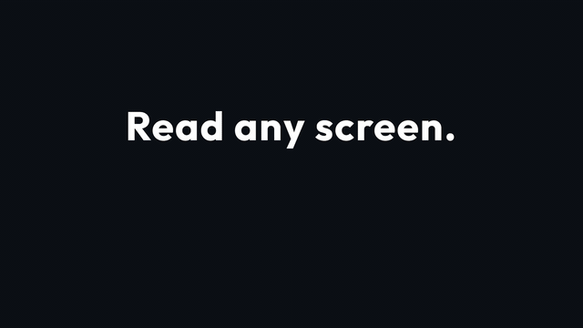

# Screen Translator

**English** | [繁體中文](#screen-translator-螢幕翻譯)

**[⬇ Download for Windows, Mac or Android | 下載 Windows / Mac / Android 版](https://github.com/MilkteaTW1/screen-translator/releases/latest)** (free, MIT)

**Read any app, game or web page in your own language: the translation is drawn right above the original text, and it can run with no internet at all.**

[](https://github.com/MilkteaTW1/screen-translator/actions/workflows/test.yml)
[](https://github.com/MilkteaTW1/screen-translator/releases/latest)




<!-- Screenshot slots (add the files to docs/ when ready):
     docs/screenshot-web.png      a web page with translations above each paragraph
     docs/screenshot-game.png     region / game mode over a dialogue box
     docs/screenshot-settings.png the settings window (Translate tab) -->

## Quick start

1. Download `ScreenTranslator-Setup-x.y.z.exe` from the [latest release](https://github.com/MilkteaTW1/screen-translator/releases/latest) and install it (no admin rights needed).
2. Pick the language on screen and the language you want; press **Start screen translation**.
3. Translations appear above each block of text. **Ctrl+Alt+T** starts/stops, **Ctrl+Alt+H** hides them,
   **Ctrl+Alt+R** limits it to a rectangle (subtitles, a game's dialogue box).

## Privacy: what stays on your computer

| Step | Where it runs |
| --- | --- |
| Reading the screen (OCR) | Always on your computer (Windows OCR / Apple Vision / ML Kit on Android) |
| Translation, default | Google Translate: the recognised text is sent to Google |
| Translation, offline | Untick **Use Google Translate first** (Quality tab): Argos Translate (or the optional TranslateGemma 4B model) translates on your computer, nothing leaves it |
| Translation, your choice | Your own DeepL key, Gemini key, LibreTranslate or Ollama / LM Studio server |
| Speech captions | Whisper / sherpa-onnx, always on your computer |

No account, no telemetry. The only other network requests are the update check on GitHub and the downloads you agree to (language packs, speech models).
Google's answers are remembered in a local file so the same text is not sent twice; turning that option off deletes it.

## Supported languages

- **Translate into**: English, Chinese (Traditional / Simplified), Japanese, Korean, French, German, Spanish, Russian,
  Italian, Portuguese, Thai, Vietnamese, Indonesian, Arabic.
- **Read from the screen**: any language Windows OCR has installed (Settings > Time & language > Language & region),
  or *auto* to read every installed one. Offline translation works for the 15 languages above (it needs the matching
  Argos pack, which the app offers to download); other screen languages are translated by Google or your own server only.
- **Interface**: English and Traditional Chinese; [adding a language](src/screen_translator/locales/README.md) is one JSON file.

## About

A free screen translator for Windows, macOS and Android. It reads the text on your screen with the built-in
OCR (Windows OCR, Apple Vision on the Mac), translates it with Google Translate (or fully offline with
[Argos Translate](https://github.com/argosopentech/argos-translate) when there is no internet or you turn Google off),
and draws the translation in a click-through overlay directly **above** each text block, centred on it.
Your normal use of the computer is not disturbed.

## Features

- Pick the screen language and the target language in the settings window. Missing offline language
  packs are offered for download right when you pick a language (you confirm first).
- Proper nouns are never translated: a do-not-translate list plus automatic detection
  (capitalised mid-sentence words, ALL CAPS, CamelCase, optional katakana).
- Wrapped lines are merged into sentences (split on `. ! ?`), so paragraphs are translated as a whole.
- Stable overlay: a block must be seen twice before it is shown, tracked blocks keep their position,
  and the translation box is placed only from its own block (never re-chosen from its surroundings).
- The overlay and settings window are excluded from screen capture, so the app never re-translates itself
  (a tray option lets screenshots include translations).
- Speech translation (Windows): listens to what the computer plays (or the microphone), transcribes it offline with
  Whisper and lists what was said with its translation in a strip at the bottom of the screen. The speech model
  (tiny 75 MB / base 145 MB / small 485 MB) is downloaded only after you choose: download now, use a model folder
  you already have (it also finds models in the Hugging Face cache), or not now.
- Shortcuts that work in any program: Ctrl+Alt+T start/stop, Ctrl+Alt+H hide/show translations, Ctrl+Alt+R choose a region.
- Region and game / video mode: translate only a rectangle you drag (subtitles, a game's dialogue box), scanned faster, with boxes over vanished text dropped sooner.
- Hover mode: a translation shows only while the mouse is over its text.
- DeepL or Gemini with your own key (Quality tab on the PC, same tab on the phone) can be used before Google. A key is tested as soon as you paste it: one real request, then a green tick or a red cross with the reason.
- Captions are yours to shape (Speech tab, phone too): width, text size, background, top or bottom of the screen, number of lines, and whether the original words show under the translation. A sample appears while you change them.
- Speech language: *Auto* hears any language Whisper knows and uses the accurate engine; choose English, Chinese, Japanese, Korean, Russian, Thai, Vietnamese, Arabic or Indonesian to get the fast word-by-word captions.
- macOS: the same app using Apple Vision OCR (`.dmg` in Releases; built by CI and not yet tested on a real Mac by the author, so please report problems; speech from the Mac's own sound needs the free BlackHole driver).
- Best offline wording (optional 2.5 GB download): Google's TranslateGemma 4B improves the quick offline draft in the background (Windows).
- Light on resources: runs at below-normal priority, 2 translation threads, no torch/spacy; starts in about a second
  and can start with Windows, minimised to the tray, translating right away.
- Translates with Google Translate first (the text is sent to Google; can be turned off in the settings) and falls back
  to the built-in offline model when there is no internet.
- Configurable refresh interval (0 s and up; the real limit is OCR speed).
- Settings are sorted into tabs (Translate, Speech, Quality, General). The interface starts in the language Windows is
  set to and can be switched with the language button at the top of the window.

## Requirements

- Windows 10/11, or macOS (Apple Silicon), or Android 8+
- Python 3.10 - 3.12 (only when running from source)
- Windows: OCR language pack for the screen language (Settings > Time & language > Language & region)

## Download

Download `ScreenTranslator-Setup-x.y.z.exe` from the [latest release](../../releases/latest) and run it (about 70 MB, no admin
rights needed; an optional task starts it with Windows). Language packs are **not** bundled: the app asks before
downloading each one (50-100 MB), or you can import `.argosmodel` files you already have.
The installer is not code-signed, so Windows SmartScreen may warn: click *More info*, then *Run anyway*.
Translation goes to Google by default (the text is sent to Google); turn it off in the settings to stay fully offline.
Optionally set your own server (Quality tab: LibreTranslate, or an OpenAI-compatible one such as Ollama or LM Studio). It is used when Google cannot be, before the offline model. The text goes only to that address; the API key is saved in `settings.json` as plain text.
The app downloads no model for this; it is for people who already run a server. If you set one up just for this, a small model (around 1 GB, such as a 1-2B instruct model) is enough for short lines.
When a translation has to be laid over its text, it is painted in the page's own colour so it reads as the text replaced; the round button hides the covers to show the original.
A setting (off by default) hides all translations while the page scrolls and shows them when it stops, which some people find easier on the eyes.
When text is read but cannot be translated, the app says why once (Google refusing, no internet, offline pack missing, offline engine broken); Settings > General > Test translation shows what works. The X button asks the first time whether to keep running in the tray or quit everything, and remembers the answer (changeable in General).
Google's translations are remembered in `%APPDATA%\ScreenTranslator\translations.jsonl` so the same text is not sent again. That file is plain text and holds what was on your screen; turn the option off in the settings and it is deleted.

## macOS

Download `ScreenTranslator-x.y.z.dmg` from the [Releases](../../releases) page and drag the app to Applications. It is not notarised: the first time, right-click the app and choose *Open*. Allow *Screen Recording* when asked (needed to read the screen). Hotkeys need *Input Monitoring*.

## Android

Download `ScreenTranslator-x.y.z.apk` from the [Releases](../../releases) page (one file for every phone, Android 8+).
It uses Google ML Kit on the phone: on-device OCR and translation, no account. Translation language data
(about 30 MB per language) is downloaded only after you choose how: Wi-Fi only, any network, or not now.
Chinese/Japanese/Korean text recognition models are fetched by Google Play services the first time they are used.

1. Pick the screen language and the language to translate to, press **Start**.
2. Allow *Display over other apps*, then press Start again, and allow screen capture.
3. In the capture dialog choose **Share entire screen** (not "one app"). A notification lets you stop it.

The translation is drawn in free space next to its text block when there is some; on a small, crowded screen it
is laid over the original instead, shrunk to fit. Proper nouns are left alone.

**Updates**: the app checks GitHub for a newer release when you open it (at most every 12 hours) and from the
*Check for updates* button. It downloads the APK and hands it to Android's installer; Android always asks you to
confirm, and the first time you must allow *Install unknown apps* for Screen Translator. Updates only install over
a copy signed with the same key, so keep installing the APKs from the Releases page.

The source is in
[`android/`](android) (Kotlin; build with Gradle and JDK 17). The APK is signed with the debug key, so it installs by
sideloading; Traditional Chinese output converts ML Kit's Simplified Chinese with ICU.

**Related free tools:** need Simplified Chinese turned into Traditional with Taiwan wording, or the spacing between Chinese and English tidied in a document? See the [Traditional/Simplified converter](https://inkacuity.com/en/tools/chinese-converter) and the [Chinese and English spacing fixer](https://inkacuity.com/en/tools/text-fixer). They run in your browser.

## Install and run from source

```bat
python -m venv .venv
.venv\Scripts\pip install -r requirements.txt
.venv\Scripts\python scripts\download_packs.py en>zt     :: example: English -> Traditional Chinese
run.bat
```

The app also asks to download missing packs when you choose a language. Argos language packs are downloaded once (about 50-100 MB each) and then work offline.
Pairs that do not involve English go through English, so `ja>zt` needs `ja>en` and `en>zt`.
Argos codes: `zh` = Simplified Chinese, `zt` = Traditional Chinese.

The X button on the settings window asks the first time whether to keep running in the tray or quit. Settings are stored in `%APPDATA%\ScreenTranslator\settings.json`.
The hidden `region` setting (`[left, top, width, height]`) limits scanning to part of the screen.

## Build a standalone exe

```bat
.venv\Scripts\pip install -r requirements-dev.txt
build.bat
```

The result is `dist\ScreenTranslator\`. The exe build is large (Qt and Argos) and has not been tested
on many machines; see [docs/KNOWN_ISSUES.md](docs/KNOWN_ISSUES.md).

## Development

```bat
.venv\Scripts\pip install -r requirements-dev.txt
.venv\Scripts\python -m pytest
```

See [CONTRIBUTING.md](CONTRIBUTING.md) and [docs/ARCHITECTURE.md](docs/ARCHITECTURE.md).
To add an interface language, add one JSON file to [src/screen_translator/locales](src/screen_translator/locales); the
[README there](src/screen_translator/locales/README.md) explains how.
Help is wanted on everything in [docs/KNOWN_ISSUES.md](docs/KNOWN_ISSUES.md).

## Need something custom?

Custom features, integrations or setup help are available. See [墨鋒 Inkacuity](https://inkacuity.com/services/simple-programming) or email [ink@inkacuity.com](mailto:ink@inkacuity.com).

## License

MIT

---

# Screen Translator 螢幕翻譯

[English](#screen-translator) | **繁體中文**

**任何程式、遊戲、網頁,譯文直接顯示在原文正上方;不連網也能用。**


## 快速開始

1. 到 [Releases](https://github.com/MilkteaTW1/screen-translator/releases/latest) 下載 `ScreenTranslator-Setup-x.y.z.exe` 安裝(不需系統管理員權限)。
2. 選「螢幕上的語言」與「要翻成的語言」,按 **開始翻譯畫面**(英文介面是 Start screen translation)。
3. 譯文會出現在每段文字上方。**Ctrl+Alt+T** 開始/停止、**Ctrl+Alt+H** 隱藏譯文、
   **Ctrl+Alt+R** 只翻譯框選的範圍(字幕、遊戲對話框)。

## 隱私:哪些東西留在你的電腦

| 步驟 | 在哪裡執行 |
| --- | --- |
| 讀取螢幕文字(OCR) | 一律在本機(Windows OCR / Apple Vision / Android 的 ML Kit) |
| 翻譯(預設) | Google 翻譯:辨識出的文字會傳給 Google |
| 翻譯(離線) | 在「品質」分頁取消勾選「優先使用 Google 翻譯」:由本機的 Argos Translate(或選用的 TranslateGemma 4B)翻譯,資料不離開電腦 |
| 翻譯(自選) | 你自己的 DeepL / Gemini 金鑰、LibreTranslate,或 Ollama / LM Studio 伺服器 |
| 語音字幕 | Whisper / sherpa-onnx,一律在本機 |

不需帳號、沒有使用追蹤。其他連線只有 GitHub 的更新檢查,以及你同意後才進行的下載(語言包、語音模型)。

## 支援語言

- **翻成**:英文、繁體中文、簡體中文、日文、韓文、法文、德文、西班牙文、俄文、義大利文、葡萄牙文、泰文、越南文、印尼文、阿拉伯文。
- **讀取**:Windows 已安裝 OCR 的任何語言(設定 > 時間與語言 > 語言與區域),或選 *auto* 讀取所有已安裝語言。上面 15 種語言可以離線翻譯(需要對應的 Argos 語言包,程式會詢問後下載);其他語言只能用 Google 或你自己的伺服器翻譯。
- **介面**:英文、繁體中文;[新增介面語言](src/screen_translator/locales/README.md)只要一個 JSON 檔。

## 簡介

免費的 Windows、macOS 與 Android 螢幕翻譯工具。它用系統內建 OCR(Windows OCR、Mac 的 Apple Vision)讀取螢幕上的文字,
用 Google 翻譯翻譯(沒有網路或關掉 Google 時,改用 [Argos Translate](https://github.com/argosopentech/argos-translate) 完全離線翻譯),
並把譯文顯示在每個文字區塊的**正上方**(水平置中)。
半透明覆蓋層可點穿,不影響你平常操作電腦。

## 功能

- 在設定視窗自選螢幕上的語言與要翻譯成的語言。選語言時如果缺少離線語言包,
  會先詢問你,同意後才下載。
- 專有名詞不翻譯:可自訂「不翻譯清單」,也會自動偵測(句中大寫開頭、全大寫、CamelCase、可選的片假名)。
- 依句號、問號、驚嘆號判斷句子,被視窗邊框切斷的換行會合併成完整句子再翻譯。
- 畫面穩定:文字區塊要連續看到兩次才顯示,已追蹤的區塊會固定位置,
  譯文位置只由自己的區塊決定,不會在上下左右之間跳來跳去。
- 覆蓋層與設定視窗不會被截圖拍到,所以不會翻譯到自己的譯文(托盤選單可改成讓截圖包含譯文)。
- 語音翻譯(Windows):聽電腦播放的聲音(或麥克風),用 Whisper 離線轉成文字,
  並把「聽到的內容與翻譯」列在螢幕下方。語音模型(tiny 75 MB / base 145 MB / small 485 MB)
  由你決定怎麼取得:現在下載、使用你已有的模型資料夾(也會自動找 Hugging Face 快取裡的模型)、或暫不下載。
- 快捷鍵(任何程式中都能用):Ctrl+Alt+T 開始/停止、Ctrl+Alt+H 隱藏/顯示譯文、Ctrl+Alt+R 選擇區域。
- 區域與遊戲/影片模式:只翻譯你框選的矩形(字幕、遊戲對話框),掃描更快,消失的文字更快移除。
- 懸停模式:滑鼠移到文字上才顯示該處譯文。
- 可在「品質」分頁使用自己的 DeepL 或 Gemini 金鑰,排在 Google 之前(手機版同樣在「品質」分頁)。貼上金鑰後會自動測試:實際呼叫一次,成功顯示綠色勾勾,失敗顯示紅色叉叉和原因。
- 字幕外觀可自訂(語音分頁,手機版也有):寬度、文字大小、底色透明度、顯示在螢幕上方或下方、同時顯示幾行、要不要在譯文下方顯示原文。調整時會先出現範例。
- 說話語言:選「自動偵測」會聽懂 Whisper 支援的任何語言,但使用準確模式;選英文、中文、日文、韓文、俄文、泰文、越南文、阿拉伯文或印尼文,才有一邊說一邊出字的快速字幕。
- 最佳離線翻譯(選用,下載 2.5 GB):Google TranslateGemma 4B 在背景把離線草稿換成更好的譯文(Windows)。
- 低資源:以低優先權執行、翻譯只用 2 個執行緒、不含 torch/spacy,約一秒啟動,
  可開機自動啟動並縮小到系統匣、啟動即開始翻譯。
- 優先使用 Google 翻譯(文字會傳送給 Google,可在設定中關閉),沒有網路時自動退回內建離線模型。
- 可自訂刷新間隔(0 秒起,實際速度受 OCR 速度限制)。
- 設定依用途分成分頁(翻譯、語音、品質、一般);介面預設使用 Windows 的語言,可用視窗上方的語言按鈕切換。

## 系統需求

- Windows 10 / 11,或 macOS(Apple 晶片版),或 Android 8 以上
- Python 3.10 ~ 3.12(從原始碼執行時)
- Windows:已安裝螢幕語言的 OCR 語言包(設定 > 時間與語言 > 語言與區域)

## 下載

到 [Releases](../../releases) 下載 `ScreenTranslator-Setup-x.y.z.exe` 並執行(約 70 MB,不需要系統管理員權限,
可勾選開機自動啟動)。語言包不包含在安裝檔裡:選語言時程式會先詢問再下載(每個 50~100 MB),
也可以匯入你已經有的 `.argosmodel` 檔。
安裝檔沒有程式碼簽章,Windows SmartScreen 可能會警告:按「其他資訊」再按「仍要執行」。
翻譯預設會送到 Google(文字會傳給 Google);在設定中關閉後才是完全離線。
可在「品質」分頁設定自己的伺服器(LibreTranslate,或 Ollama、LM Studio 這類 OpenAI 相容的),Google 不能用時先用它,再退回離線模型。文字只會送到你填的位址;API 金鑰以明文存在 `settings.json`。
程式不會為此下載任何模型,這是給本來就有在跑伺服器的人用的。如果要特地架一個,小模型(約 1 GB,例如 1~2B 的 instruct 模型)翻短句就夠了。
翻譯框必須蓋在原文上時,會用該處頁面的底色,看起來像原文被換掉;小圓鈕可一鍵隱藏覆蓋、看原文。
有個設定(預設關閉)可在頁面捲動時先隱藏所有翻譯,停下來再顯示,有些人覺得這樣視覺上比較舒服。
有辨識到文字卻無法翻譯時,程式只會說明一次原因(Google 拒絕、沒網路、缺離線語言包、離線引擎出錯);「設定 > 一般 > 測試翻譯」可看哪些可用。按 X 時,第一次會問要縮到系統匣繼續執行還是全部關閉,並記住答案(可在「一般」更改)。
Google 的翻譯會記在 `%APPDATA%\ScreenTranslator\translations.jsonl`,相同文字不會重新送出。這個檔案是明文,內容就是你螢幕上出現過的文字;在設定中關閉這個選項就會刪除。

## macOS

到 [Releases](../../releases) 下載 `ScreenTranslator-x.y.z.dmg`,把 App 拖到「應用程式」。未經公證:第一次請按右鍵選「打開」。需要允許「螢幕錄製」(讀取螢幕用),快捷鍵需要「輸入監控」。作者尚未在真實 Mac 上測試過(由 CI 建置),遇到問題請回報。

## Android 手機版

到 [Releases](../../releases) 下載 `ScreenTranslator-x.y.z.apk`(一個檔案適用所有手機,Android 8 以上)。
使用 Google ML Kit 在手機本機做 OCR 與翻譯,不需要帳號。翻譯語言資料(每個語言約 30 MB)
會先問你要怎麼下載(僅 Wi-Fi、任何網路、或暫不下載)才會下載;中日韓文字辨識模型由 Google Play 服務在第一次使用時下載。

1. 選螢幕語言與要翻譯成的語言,按 **Start**。
2. 允許「顯示在其他應用程式上層」,再按一次 Start,並允許螢幕擷取。
3. 擷取視窗請選 **分享整個螢幕**(不要選「單一應用程式」)。通知欄可以隨時停止。

譯文有空白處就顯示在文字區塊旁邊;畫面小又擠的時候,會縮小字體直接蓋在原文上。專有名詞不翻譯。

**更新**:開啟 App 時(最多每 12 小時一次)和按「Check for updates」都會到 GitHub 檢查新版,下載 APK 後交給
Android 安裝程式。安裝一定要你按確認,第一次還需要允許 Screen Translator「安裝未知應用程式」。只有簽章相同的 APK
才能覆蓋安裝,所以請一律從 Releases 頁面下載。

原始碼在 [`android/`](android)(Kotlin,用 Gradle 與 JDK 17 建置)。
APK 以 debug 金鑰簽署,可直接側載安裝;繁體中文是把 ML Kit 的簡體輸出用 ICU 轉換而來。

**相關免費工具:** 要把簡體轉成台灣用語的繁體,或整理文件裡中英文之間的空格?可以用[繁簡轉換(台灣用語)](https://inkacuity.com/tools/chinese-converter)和[中英文間距修正](https://inkacuity.com/tools/text-fixer),都在瀏覽器裡執行。

## 從原始碼執行

```bat
python -m venv .venv
.venv\Scripts\pip install -r requirements.txt
run.bat
```

第一次選語言時程式會詢問是否下載離線語言包(每個約 50~100 MB,只需下載一次)。
也可以手動下載:`.venv\Scripts\python scripts\download_packs.py en>zt`。
不含英文的語言對會經由英文轉譯,例如 `ja>zt` 需要 `ja>en` 與 `en>zt`。
Argos 代碼:`zh` = 簡體中文、`zt` = 繁體中文。

按設定視窗的 X 時,第一次會問要縮到系統匣還是全部關閉。設定檔存放在 `%APPDATA%\ScreenTranslator\settings.json`。
隱藏設定 `region`(`[左, 上, 寬, 高]`)可以限制只掃描螢幕的一部分。

## 開發

```bat
.venv\Scripts\pip install -r requirements-dev.txt
.venv\Scripts\python -m pytest
build.bat
```

詳見 [CONTRIBUTING.md](CONTRIBUTING.md)、[docs/ARCHITECTURE.md](docs/ARCHITECTURE.md)。
想新增介面語言,只要在 [src/screen_translator/locales](src/screen_translator/locales) 加一個 JSON 檔,
做法見[該資料夾的說明](src/screen_translator/locales/README.md)。
歡迎協助 [docs/KNOWN_ISSUES.md](docs/KNOWN_ISSUES.md) 裡列出的問題。

## 需要客製？

想要專屬功能、整合或部署協助？歡迎找我，詳情請見 [墨鋒 Inkacuity](https://inkacuity.com/services/simple-programming)，或寄信到 [ink@inkacuity.com](mailto:ink@inkacuity.com)。

## 授權

MIT
